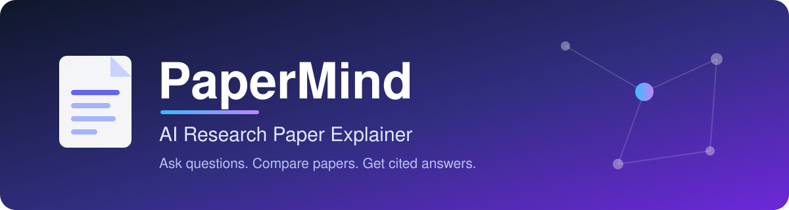
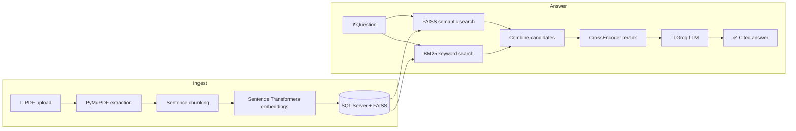

<div align="center">



<br>

**Upload up to three research papers, ask questions in plain language, and get answers grounded only in your papers, with page-level citations.**

<br>


[Features](#-features) •
[How It Works](#-how-it-works) •
[Quick Start](#-quick-start) •
[API](#-api-reference) •
[Security](#-security) •
[Deployment](#-deployment)

</div>

---

## 📖 About

**PaperMind** is a Retrieval-Augmented Generation (RAG) web app built with FastAPI. It saves each paper independently in SQL Server, retrieves evidence with a hybrid semantic and keyword search, reranks it, and asks an LLM to answer strictly from that evidence.

Select two or three papers to compare approaches, results, and claims side by side.

<!--
Add a screenshot or demo GIF here once you have one:
<p align="center"></p>
-->

---

## ✨ Features

| | Feature | Description |
|---|---|---|
| 📄 | **Multi-paper Q&A** | Upload 1 to 3 PDFs and query any selection of them |
| ⚖️ | **Paper comparison** | Compare methods and evidence across two or three papers |
| 🔗 | **Cited answers** | Claims are tied to sources as `[Paper <id>, p. <page>]` |
| 🔎 | **Hybrid retrieval** | FAISS semantic search plus BM25 keyword search, per paper |
| 🎯 | **Reranking** | A CrossEncoder puts the strongest evidence in front of the model |
| 🎓 | **Explanation levels** | Tailor answers to the reader, such as `undergraduate` |
| 🔐 | **Private accounts** | Sign up, log in, and keep your papers scoped to you |
| 💾 | **Saved library** | Papers persist in SQL Server, so you can reload them anytime |

---

## 🧠 How It Works



1. **Ingest**: PyMuPDF extracts the text, which is split into sentence-based chunks and embedded.
2. **Retrieve**: for each selected paper, semantic and keyword retrieval run independently.
3. **Rerank**: candidates from all selected papers are combined and reranked.
4. **Generate**: the top excerpts, labeled with paper ID, filename, page, and section, go to Groq, which writes a cited answer.

---

## 🧰 Tech Stack

| Layer | Technology |
|---|---|
| **Backend** | Python, FastAPI, Uvicorn |
| **Database** | Microsoft SQL Server |
| **PDF parsing** | PyMuPDF |
| **Embeddings** | Sentence Transformers |
| **Semantic search** | FAISS |
| **Keyword search** | BM25 |
| **Reranking** | CrossEncoder |
| **LLM** | Groq API |
| **Auth** | JWT, bcrypt |
| **Frontend** | HTML, CSS, vanilla JavaScript |

---

## 🚀 Quick Start

### Prerequisites

- Python 3.10 or newer
- A SQL Server instance and the matching ODBC driver
- A [Groq API key](https://console.groq.com/)

### 1. Clone and enter the project

```bash
git clone https://github.com/AnushkaAchavan/research-paper-assistant.git
cd research-paper-assistant
```

### 2. Create a virtual environment and install dependencies

```bash
python -m venv .venv

# Windows (PowerShell)
.venv\Scripts\Activate.ps1

# macOS / Linux
source .venv/bin/activate

pip install -r requirements.txt
```

### 3. Set up the database

Create a SQL Server database (default name `PaperMind`) and run [`database/schema.sql`](database/schema.sql).

> 💡 The script is safe to re-run. It creates missing tables and indexes and never deletes records.

### 4. Configure environment variables

Create a `.env` file in the project root:

```env
GROQ_API_KEY=your_groq_api_key
SQL_SERVER=localhost
SQL_DATABASE=PaperMind
JWT_SECRET=replace_with_a_long_random_secret
```

<details>
<summary><b>What do these variables do?</b></summary>

<br>

| Variable | Description |
|---|---|
| `GROQ_API_KEY` | API key used to generate answers |
| `SQL_SERVER` | SQL Server host name |
| `SQL_DATABASE` | Database name (default `PaperMind`) |
| `JWT_SECRET` | Secret for signing login tokens. **Required**: the app will not start without it. |

Generate a strong secret:

```bash
python -c "import secrets; print(secrets.token_urlsafe(48))"
```

</details>

> ⚠️ **Never commit your `.env` file.** Keep it listed in `.gitignore`.

### 5. Run the app

```bash
uvicorn main:app --reload
```

Open **<http://127.0.0.1:8000/login>**, create an account, and upload your first paper.

---

## 💬 Usage

1. **Sign up or log in** at `/login`.
2. **Upload** one to three PDFs.
3. **Select** the papers you want to query.
4. **Ask**, for example:
   - *"What problem does this paper solve?"*
   - *"Explain the methodology in simple terms."*
   - *"Compare the approaches used in these papers."*
5. **Verify** each claim using the page citations in the answer.

---

## 🔌 API Reference

Every endpoint except signup and login needs an `Authorization: Bearer <token>` header.

| Method | Endpoint | Description |
|:---:|---|---|
| `POST` | `/auth/signup` | Create an account; returns a JWT and user profile |
| `POST` | `/auth/login` | Log in; returns a JWT and user profile |
| `GET` | `/auth/me` | Verify the current token and return the user |
| `POST` | `/upload` | Upload and index a paper |
| `GET` | `/papers` | List your saved papers |
| `POST` | `/load/{paper_id}` | Load a saved paper for querying |
| `DELETE` | `/papers/{paper_id}` | Delete one of your papers |
| `POST` | `/ask` | Ask a question over the selected papers |

<details>
<summary><b>Example <code>/ask</code> request</b></summary>

```json
{
  "question": "Compare the approaches used in these papers.",
  "paper_ids": [1, 2],
  "level": "undergraduate",
  "mode": "normal"
}
```

</details>

---

## 📁 Project Structure

<details>
<summary><b>Show file tree</b></summary>

```
.
├── main.py              # FastAPI app: auth, upload, retrieval, Q&A
├── requirements.txt     # Python dependencies
├── docs/
│   └── banner.svg       # README banner
├── database/
│   └── schema.sql       # SQL Server schema (safe to re-run)
├── static/
│   ├── script.js        # Main app logic
│   ├── style.css        # Main app styles
│   ├── auth.js          # Login / signup logic
│   └── auth.css         # Auth page styles
└── templates/
    ├── index.html       # Main application page
    ├── login.html       # Login page
    └── signup.html      # Signup page
```

</details>

---

## 🔒 Security

- 🔑 Passwords are hashed with **bcrypt** and never stored in plain text.
- 🎫 Login uses signed **JWTs**. The browser verifies the token through `/auth/me` on each load and clears it on logout or expiry.
- 🧍 Every paper operation is **scoped to its owner**, so one account cannot read or change another's papers.
- 🗃️ Papers uploaded before authentication existed are intentionally left unassigned and are not visible to any account. Assign them to a user in SQL if you want to keep them.
- 🌱 Secrets come from **environment variables**, never from source code.

---

## ☁️ Deployment

Deploying to **Azure App Service**:

1. Add `GROQ_API_KEY`, `JWT_SECRET`, `SQL_SERVER`, and `SQL_DATABASE` under **Settings → Environment variables**.
2. Set a production startup command:
   ```bash
   gunicorn -w 2 -k uvicorn.workers.UvicornWorker main:app
   ```
3. Allow the app through your SQL Server firewall and make sure the ODBC driver is available on the host.

---

## 🗺️ Roadmap

- [ ] More than three papers per query
- [ ] Highlight cited passages in a PDF viewer
- [ ] Export answers and comparisons
- [ ] Docker setup for one-command local runs

---

## 🤝 Contributing

Issues and pull requests are welcome. For larger changes, please open an issue first to discuss what you would like to change.

---

<div align="center">

Built with ❤️ by **[Anushka Chavan](https://github.com/AnushkaAchavan)**

⭐ If you found this project useful, consider giving it a star!

</div>
